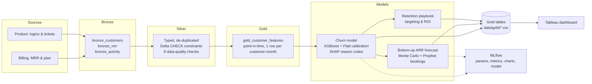
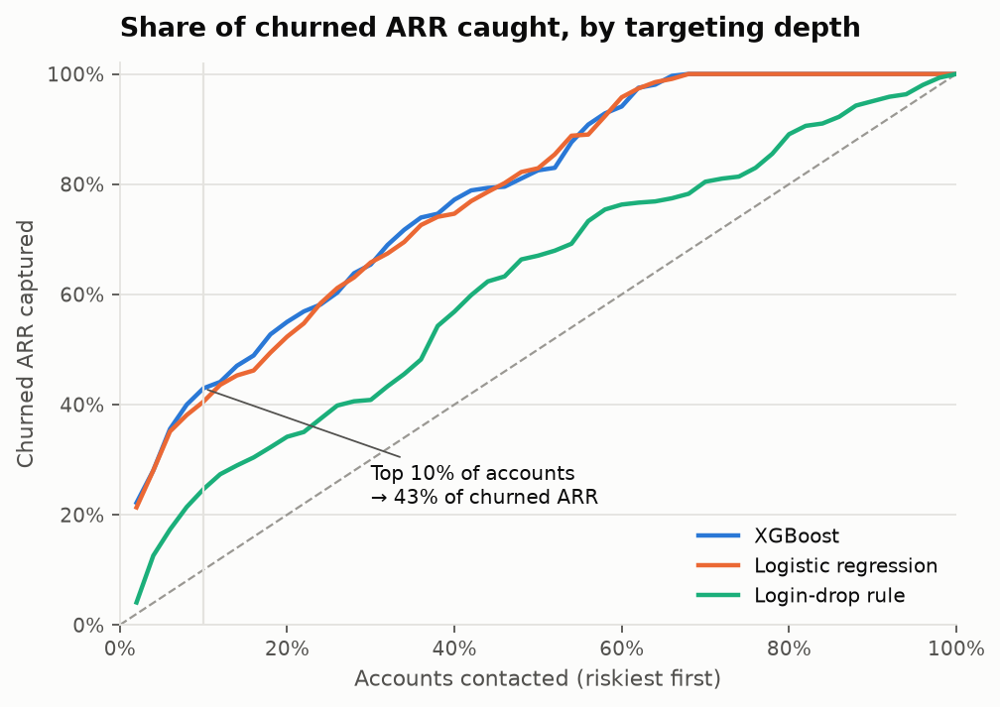
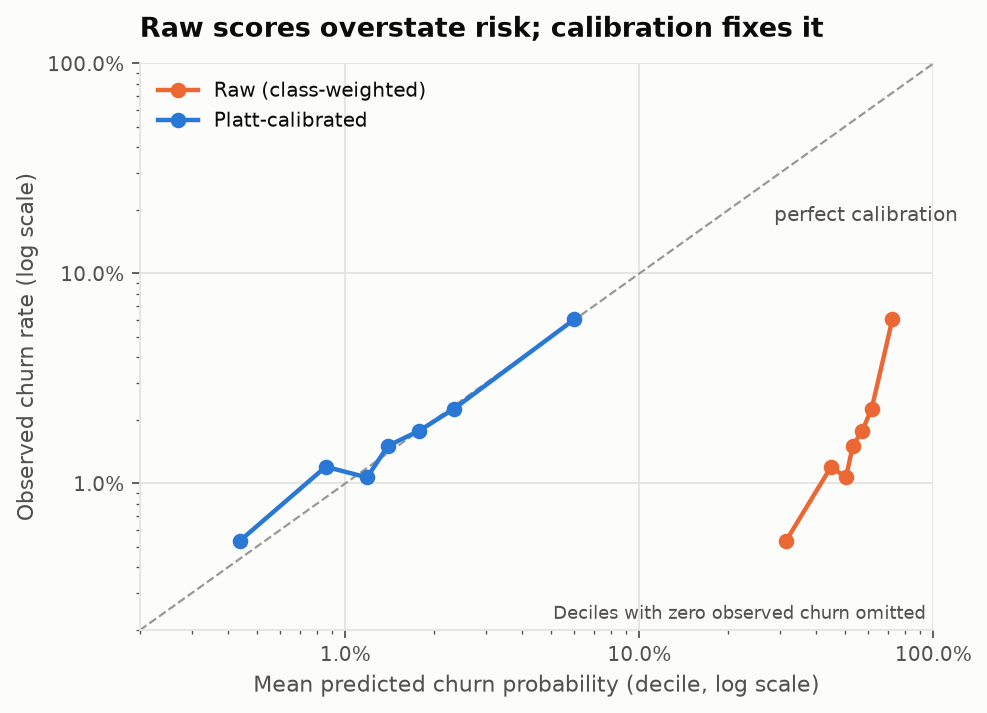
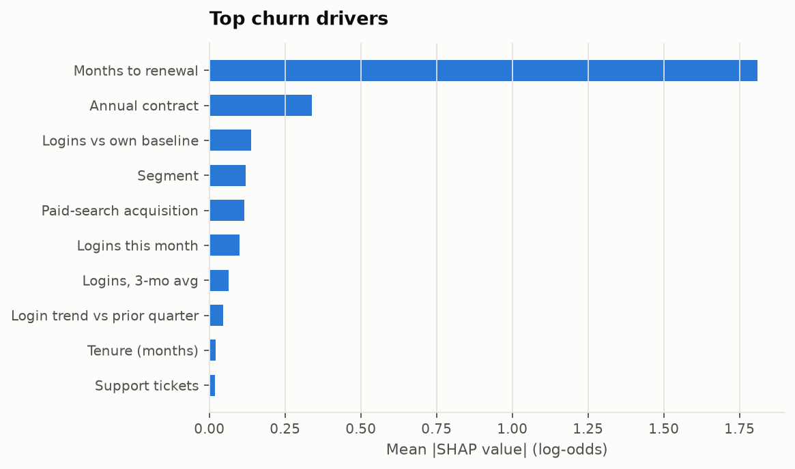
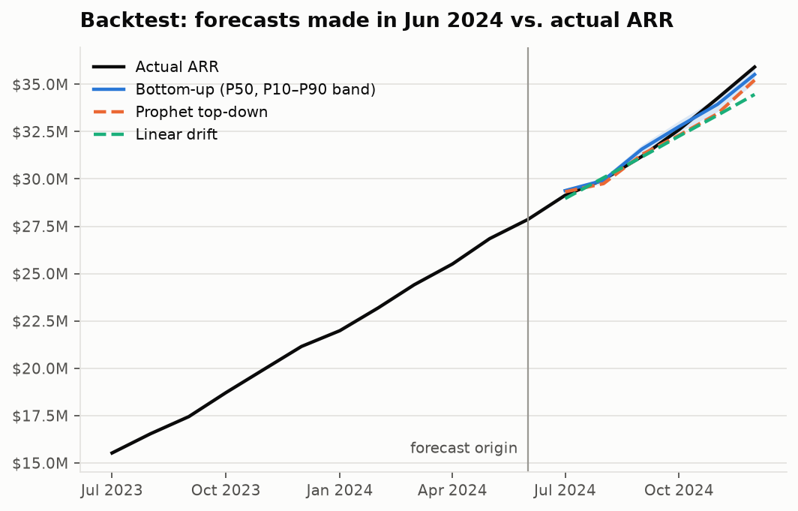
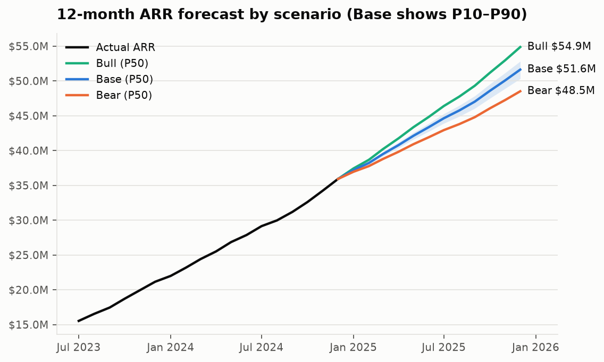
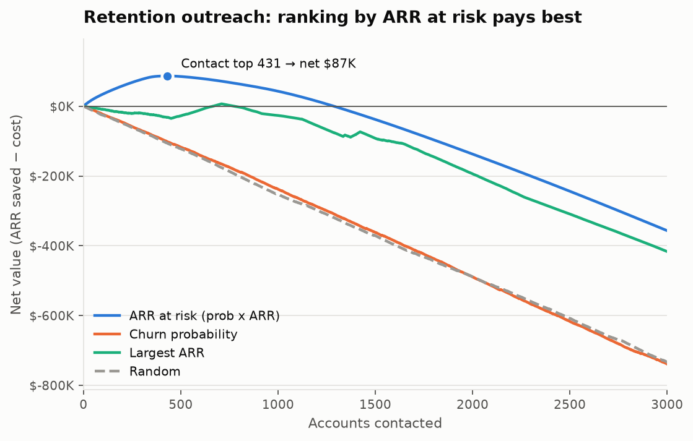
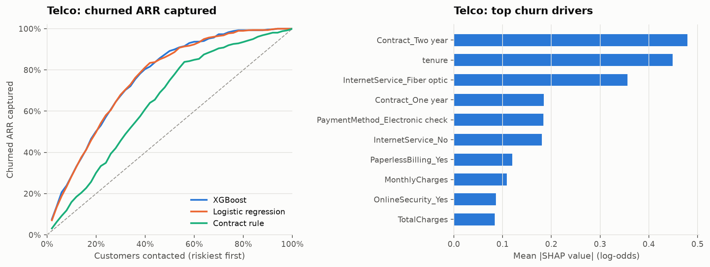

# SaaS Revenue Forecasting & Churn Risk

An end-to-end revenue intelligence pipeline on **Databricks (PySpark + Delta Lake)**. It scores every
customer's churn risk, explains each score, forecasts ARR 12 months out with a bottom-up Monte Carlo
model, and turns the result into a costed retention plan, surfaced in a **Tableau** dashboard.

**Headline results** (10,000 simulated customers, Jan 2022 – Dec 2024):

- **$5.0M of $35.9M ARR (14.0%) is at risk of churning in the next 12 months.** SMB holds 38% of ARR
  but **61% of the risk**.
- The churn model catches **43% of churned ARR by contacting just the riskiest 10% of accounts**, and
  its probabilities are calibrated: **315 predicted churners vs. 324 actual** in the held-out months.
- The bottom-up ARR forecast had a **0.8% error (MAPE)** in a 6-month backtest. That beats Prophet
  top-down (1.1%), linear drift (1.5%) and a naive forecast (12.9%).
- Base-case ARR reaches **$51.6M by Dec 2025** (P10–P90: $50.3M–$52.8M). The Bear and Bull scenarios
  give $48.5M and $54.9M.
- Contacting the **top 431 accounts ranked by ARR at risk** has an expected net value of **+$87K**
  (50% ROI). Ranking by churn probability alone loses money at every depth.

---

## Architecture



Each stage is its own notebook, and the stages run as one scheduled multi-task **Databricks Job**
(defined in [databricks.yml](databricks.yml)). Shared logic lives in the
[revenue_pipeline/](revenue_pipeline/) package, so it can be unit-tested.

| Notebook | What it does |
|---|---|
| [01_bronze_ingest](notebooks/01_bronze_ingest.ipynb) | Simulates the raw billing and product feeds, including realistic defects |
| [02_silver_transform](notebooks/02_silver_transform.ipynb) | Types, de-duplicates and quarantines bad rows; enforces Delta constraints and data-quality checks |
| [03_gold_features](notebooks/03_gold_features.ipynb) | Point-in-time features and next-month churn labels |
| [04_churn_model](notebooks/04_churn_model.ipynb) | Baselines vs. XGBoost, calibration, capture curve, SHAP, current risk snapshot |
| [05_arr_forecast](notebooks/05_arr_forecast.ipynb) | Forecast backtest, bottom-up Monte Carlo, Bear/Base/Bull scenarios |
| [06_retention_playbook](notebooks/06_retention_playbook.ipynb) | Who to contact, expected ARR saved, ROI and sensitivity |
| [07_telco_validation](notebooks/07_telco_validation.ipynb) | Re-runs the modelling approach on a real public churn dataset |

---

## Results

### Churn model

Evaluated on the last 3 labelled months (Sep–Nov 2024: 22,479 customer-months, 324 churners, a 1.44%
base rate). The model is trained and calibrated only on earlier months.

| Model | ROC-AUC | PR-AUC | Churned ARR caught in top 10% | Predicted vs. actual churners |
|---|---|---|---|---|
| Rule: logins below the customer's own average | 0.621 | 0.029 | 25% | – |
| Logistic regression | 0.795 | 0.102 | 41% | 333 vs. 324 |
| **XGBoost + Platt calibration** | **0.798** | **0.108** | **43%** | **315 vs. 324** |

<p>
  
  
</p>

**Why PR-AUC and calibration, not just ROC-AUC.** With a ~1.5% base rate, ROC-AUC flatters every model.
PR-AUC and "churned ARR caught" show what a customer-success team actually gets. Calibration matters
because the scores are used as probabilities downstream: ARR at risk = P(churn) × ARR, and the forecast
uses them as hazards. Class weighting (`scale_pos_weight`) inflates raw scores roughly 25×. Platt scaling
maps them back without changing the ranking. Isotonic regression was tried first, but it created tied
scores and pushed some accounts to exactly 100%.

**XGBoost vs. logistic regression.** The gap is small, and that is the honest result. The simulated
churn process is close to log-linear, which is where logistic regression shines. XGBoost was tuned on
the calibration window, never the test window. Shallow trees (depth 2) generalised best.



Renewal timing dominates, because annual contracts can only churn at renewal. After that come
behavioural signals: logins vs. the customer's own baseline, and login trend. Every scored account gets
its **top 3 SHAP reason codes** in plain English (for example *"Logins at 36% of usual · Month-to-month
contract · Low 3-month usage"*), so the risk list is actionable.

### Current risk snapshot (Dec 2024)

| Segment | Share of ARR | 12-month ARR at risk | % of segment ARR | Share of total risk |
|---|---|---|---|---|
| SMB | 38% | $3.03M | 22.0% | **61%** |
| Mid-Market | 35% | $1.43M | 11.3% | 29% |
| Enterprise | 26% | $0.55M | 5.8% | 11% |
| **Total** | | **$5.01M** | **14.0%** | |

The model predicts *next-month* churn. The 12-month figure chains the monthly hazards from the forecast
model: P(churn within 12 months) = 1 − ∏(1 − hazard). Both horizons are in
`data/gold/gold_revenue_risk.csv`.

### ARR forecast

 

**Bottom-up, not curve-fitting.** ARR is built up from its drivers:

1. **Existing book.** Each customer's monthly churn hazard comes from the calibrated model. Tenure and
   renewal dates roll forward, and today's risk signal fades toward the historical base rate, because
   at-risk accounts often recover. Survivors expand at their segment's historical rate.
2. **New business.** Prophet forecasts monthly new-bookings ARR (trend + seasonality), and each
   simulation samples one path. New cohorts churn at the historical first-year rate.
3. **Monte Carlo.** 1,000 simulations. Each one has a shared churn shock (customers churn together in a
   bad year) plus an independent churn draw per customer. This produces the P10/P50/P90 bands.

**Backtest** (forecast made in Jun 2024 using only data available then, including a churn model
retrained on labels known at that date):

| Method | MAPE (6 months) | Bias | Actuals inside the 80% interval |
|---|---|---|---|
| Naive (last value) | 12.9% | −12.9% | – |
| Linear drift | 1.5% | −1.3% | – |
| Prophet top-down | 1.1% | −0.8% | 2 of 6 |
| **Bottom-up Monte Carlo** | **0.8%** | **+0.1%** | 4 of 6 |

**Scenarios are driver-based.** Bear means churn hazards +20% and new bookings −10%; Bull means −20% and
+10%. They flow through the same simulation, so scenario ARR stays consistent with the risk model.

| Scenario | Dec 2025 ARR (P50) | P10 – P90 | Growth vs. Dec 2024 |
|---|---|---|---|
| Bear | $48.5M | $47.1M – $49.8M | +35% |
| Base | $51.6M | $50.3M – $52.8M | +44% |
| Bull | $54.9M | $53.7M – $55.9M | +53% |

In the Base case, the existing book loses **$5.3M** of ARR to churn over 12 months while new business
adds **$19.3M**. Growth slows from +70% in 2024 to +44% because a larger base churns more dollars each
month.

### Retention playbook



Expected ARR saved = save rate × P(churn within 12 months) × ARR, against $400 of outreach cost per
account (with an assumed 25% save rate).

| Targeting strategy | Accounts | Expected ARR saved | Cost | Net value |
|---|---|---|---|---|
| **Rank by ARR at risk (P × ARR)** | **431** | **$259K** | **$172K** | **+$87K** |
| Rank by largest ARR | 710 | $291K | $284K | +$7K |
| Rank by churn probability | – | – | – | negative at every depth |
| Random | – | – | – | negative at every depth |

Ranking by probability alone fills the list with small SMB accounts that aren't worth a CSM's time. The
save rate and cost are assumptions. The notebook includes a sensitivity grid: at a 10% save rate, almost
no outreach pays; at 35%, contacting about 960 accounts does. In production, the save rate should be
measured with a holdout group.

### Validation on real data: IBM Telco churn

The main pipeline runs on simulated data, so the same modelling approach was re-run on the public
[IBM Telco Customer Churn](https://github.com/IBM/telco-customer-churn-on-icp4d) dataset (7,043
customers, 26.5% churn):

| Model | ROC-AUC | PR-AUC | Predicted vs. actual churners |
|---|---|---|---|
| Rule: month-to-month contract | 0.710 | 0.393 | – |
| Logistic regression | 0.832 | 0.619 | 378 vs. 374 |
| **XGBoost + Platt calibration** | **0.837** | **0.642** | **373 vs. 374** |

The same pattern holds on real data: XGBoost edges past logistic regression, both clearly beat the
rule, and the calibrated probabilities match the observed churn count almost exactly.



---

## Engineering details

- **No look-ahead leakage.** Features use only rows at or before the prediction month. The label fires
  on a customer's last paying month. Rows in the final month have no label (the outcome isn't known
  yet), so they are scored rather than trained on. `tests/test_features.py` proves the point-in-time
  property: features computed on data truncated at a past month are identical to the full-data features.
- **Realistic synthetic data.** Churn is driven by a hidden health state, not a scripted countdown.
  At-risk customers often recover, healthy ones have random usage dips, some churn arrives with no
  warning, and annual contracts churn only at renewal. Behavioural signals therefore help but don't
  give the answer away. Raw feeds include duplicates, null amounts and sentinel values; Silver cleans
  405 duplicate rows per feed, quarantines 143 bad MRR rows and nulls 140 sentinel logins.
- **Data quality.** Delta `CHECK` constraints plus 8 SQL checks (uniqueness, referential integrity,
  no revenue after churn, …). Any failure stops the job, and every run's results are logged to
  `silver_dq_results`.
- **Experiment tracking.** MLflow logs parameters, metrics for every model and baseline, backtest
  scores, charts and the trained model.
- **Orchestration.** [databricks.yml](databricks.yml) is a Databricks Asset Bundle that defines a
  monthly multi-task job. Forecasting and retention run in parallel once the churn model finishes.
- **CI.** GitHub Actions runs the test suite (13 tests) on every push.

## Limitations & next steps

- **Simulated data.** The headline numbers reflect a simulated company. The Telco notebook shows that
  the modelling approach transfers to real data, but the forecast and retention economics have only
  been tested on simulation.
- **Short backtest.** A single 6-month backtest from one origin is thin evidence. Rolling-origin
  backtests would give a more reliable error estimate. The 80% interval covered 4 of 6 months, so it is
  probably still somewhat too narrow.
- **Assumed retention economics.** The save rate and outreach cost should be measured with an
  experiment before the playbook drives spend.
- **Next steps:** register the model in Unity Catalog's model registry, add drift monitoring on feature
  distributions, model expansion and contraction per customer rather than per segment, and use
  multi-year customer value instead of first-year ARR in the ROI calculation.

---

## Running it

### On Databricks

```bash
databricks bundle validate
databricks bundle deploy -t dev
databricks bundle run revenue_pipeline -t dev
```

Alternatively, clone the repo as a Git folder and run notebooks `01` → `06` in order on an ML runtime
(15.4 LTS ML or later). Tables are written to the `revenue_forecasting` schema, which you can override
with the `RF_SCHEMA` environment variable.

### Locally

Requires Java (8, 11 or 17) for Spark.

```bash
python -m venv .venv && source .venv/bin/activate
pip install -r requirements-local.txt
cd notebooks
for nb in 0*.ipynb; do jupyter nbconvert --to notebook --execute --inplace "$nb"; done
cd .. && pytest
```

Locally, the pipeline starts its own Spark session with Delta Lake and a local metastore in
`.local_runtime/`, and MLflow logs to a SQLite store in the same folder. On macOS, XGBoost needs the
OpenMP runtime (`brew install libomp`).

### Dashboard

[Dashboard.twb](Dashboard.twb) reads `gold_revenue_risk.csv`, `gold_arr_forecast.csv` and
`gold_scenario_forecast.csv` from [data/gold/](data/gold/). If you move the repo, use
*Data → Edit Data Source* in Tableau Desktop to repoint those three files. `gold_revenue_risk.csv`
also includes the SHAP reason codes and risk tiers, and `data/gold/` has the backtest, capture-curve
and retention tables for further sheets.

## Repository layout

```
├── notebooks/            01–07 pipeline stages (executed, with outputs)
├── revenue_pipeline/     shared package: datagen, quality, features, modeling, forecasting, retention, charts
├── tests/                datagen invariants, label + point-in-time tests, model/simulation tests
├── data/gold/            exported gold tables (Tableau sources)
├── docs/images/          charts used in this README
├── Dashboard.twb         Tableau workbook
├── databricks.yml        Databricks Asset Bundle (scheduled multi-task job)
└── requirements*.txt     Databricks (requirements.txt) and local (requirements-local.txt) dependencies
```

**Tech stack:** Databricks · PySpark · Delta Lake · XGBoost · scikit-learn · SHAP · Prophet · MLflow ·
pandas / NumPy · Tableau · pytest · GitHub Actions
